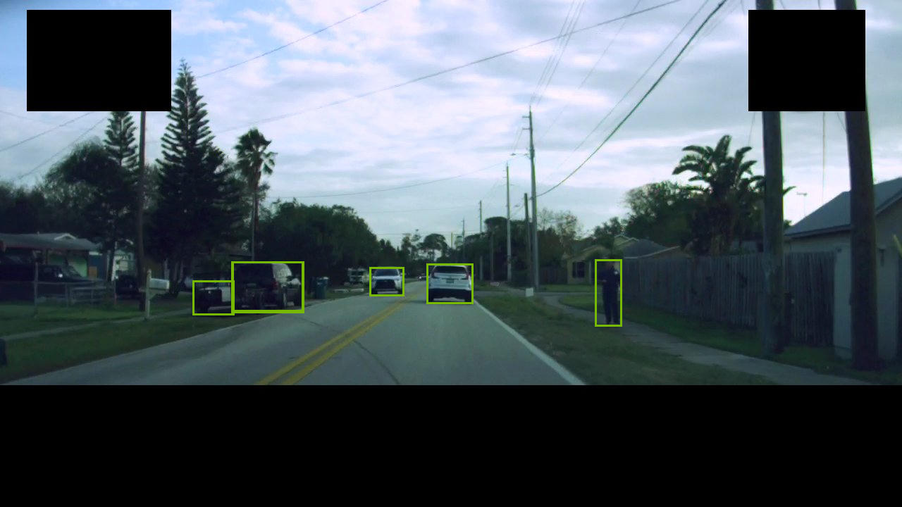
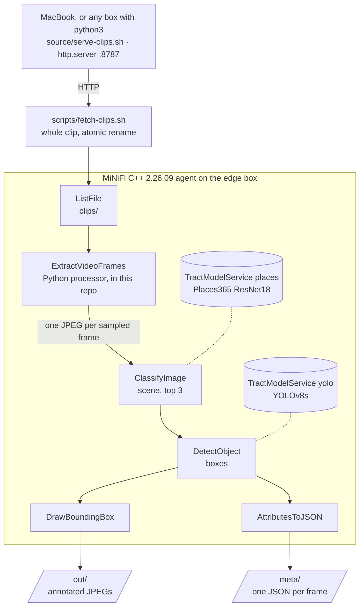
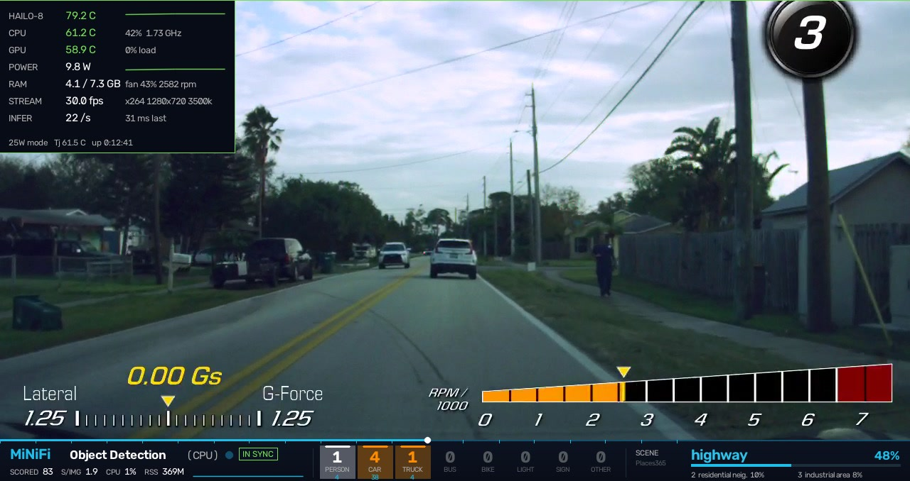
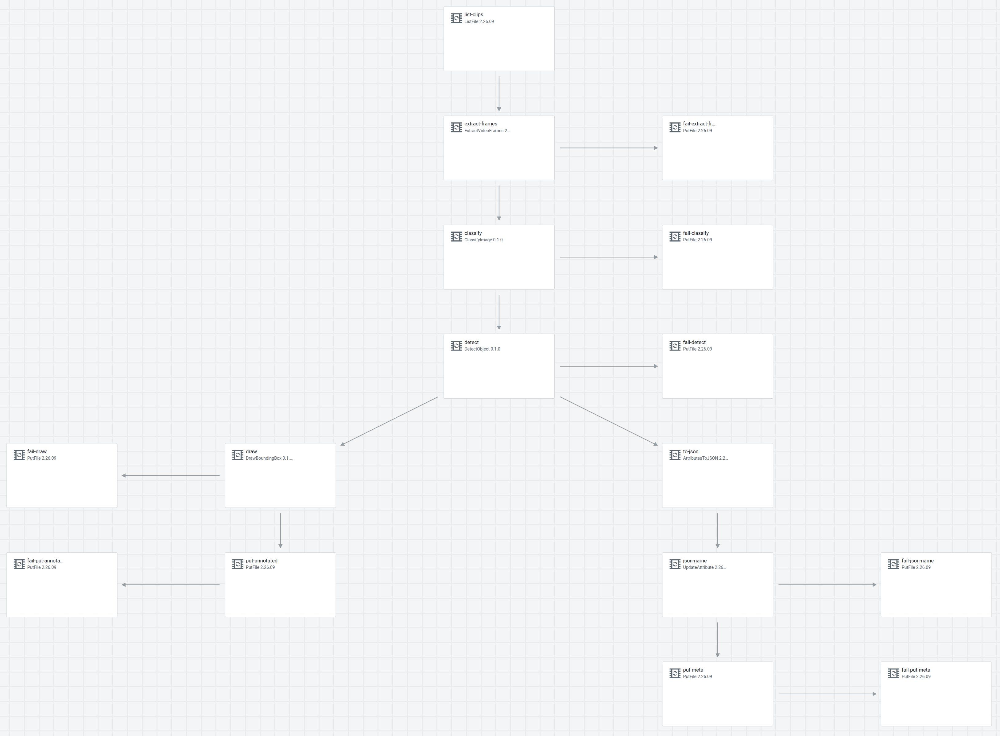
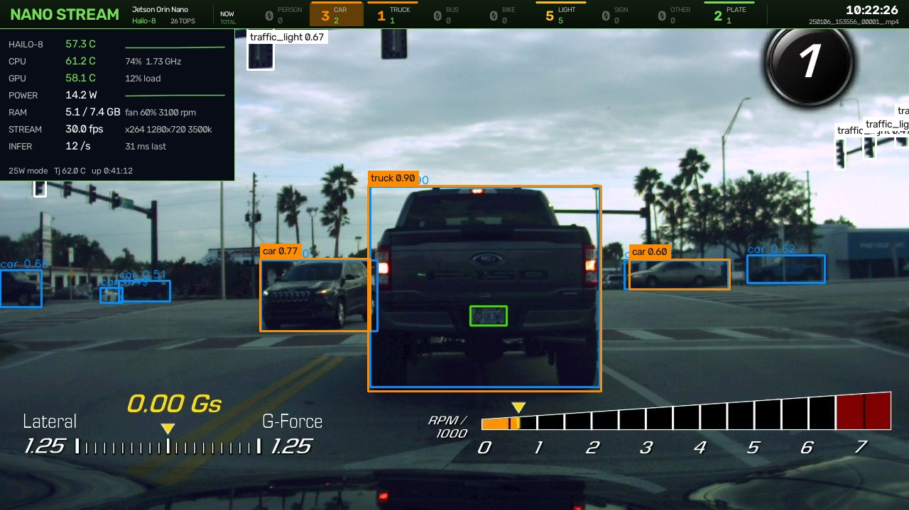

<div align="center">



# MiNiFi C++ Object Detection Demo

**Object detection and scene classification inside a MiNiFi C++ agent, on the CPU, from a dashcam clip to boxed frames and one JSON record per frame.**

The same flow runs as a bench agent, in a Kubernetes pod, as an Edge Flow Manager class and on a Jetson Orin Nano.

[](https://github.com/cldr-steven-matison/MiNiFi-C-Object-Detection/actions/workflows/ci.yml)
[](LICENSE)


[](https://developer.nvidia.com/embedded/jetson-orin-nano-developer-kit)
[](https://github.com/steven-matison/NanoStream)

</div>

---

MiNiFi C++ 2.26.09 ships a new extension, `minifi_tensor`, that runs ONNX models inside the agent. I wanted to see it do something useful with video, so this demo streams dashcam clips from a MacBook to an edge agent that cuts them into frames, labels the scene, finds the cars, trucks and people, draws the boxes and writes one JSON record per frame. Everything runs inside MiNiFi, on the CPU. The same flow runs on a laptop-sized bench agent, in a Kubernetes pod, under Edge Flow Manager, and on a Jetson Orin Nano, and this repo carries every file you need to repeat it, plus one sample clip to run it on.

[Quick start](#quick-start) · [How it works](#how-it-works) · [Get the bits](#get-the-bits) · [Build the models](#build-the-models) · [The video source](#the-video-source-on-a-macbook) · [Run 1, bench](#run-1-a-bench-agent-c2-off) · [Run 2, Kubernetes](#run-2-the-same-bench-in-a-kubernetes-pod) · [Run 3, EFM](#run-3-the-flow-from-edge-flow-manager) · [Run 4, Jetson](#run-4-a-jetson-orin-nano) · [What I measured](#what-i-measured) · [ExtractVideoFrames](#extractvideoframes) · [Traps](#traps) · [NanoStream](#nanostream)

## Quick start

One Ubuntu 24.04 x86_64 box, with the two MiNiFi C++ 2.26.09 tarballs already in `~/efm-binaries/` ([Get the bits](#get-the-bits)):

```bash
git clone https://github.com/cldr-steven-matison/MiNiFi-C-Object-Detection.git && cd MiNiFi-C-Object-Detection
sudo apt-get install -y python3 python3-venv libpython3.12t64
bash models/make-models.sh                 # the three model files, into models/build/
bash scripts/stage.sh x86_64               # base + extra extensions, one minifi.tar.gz
bash scripts/install.sh ~/efm-binaries/staging/binaries/cpp/linux/2.26.09/minifi.tar.gz ~/minifi-cpp-2.26.09
MODELS_DIR=$PWD/models/build bash scripts/run-agent.sh conf ~/minifi-cpp-2.26.09     # foreground, C2 off
```

From a second shell, hand the agent the sample clip and check the result:

```bash
cp sample/dashcam-street-30s.mp4 /tmp/minifi-detect/clips/
bash scripts/check-run.sh                  # NOT YET while it works, PASS in about a minute
```

```
annotated 30  json 30  failures 0
boxes   car 68, person 4, truck 3, traffic light 1, bus 1
scene   highway 26, residential_neighborhood 2, industrial_area 2
PASS
```

The annotated frames are in `/tmp/minifi-detect/out/` and the JSON records in `/tmp/minifi-detect/meta/`.

| You need | |
|---|---|
| The agent | MiNiFi C++ 2.26.09 build `b42`, the base and the extra-extensions tarball (CEM archive credentials) |
| The edge box | Ubuntu 24.04, x86_64 or aarch64, python 3.12 with `python3-venv` and `libpython3.12t64` |
| The model build | python 3.10 to 3.12, about 2 GB of disk for its venv, network to github.com and places2.csail.mit.edu |
| The video source | any box with `python3`; optional, the sample clip is in the repo |
| Runs 2 to 4 | `kubectl` with minikube or docker, Edge Flow Manager 2.3.1, a Jetson Orin Nano |

## What the release adds

All four components are Technical Preview and come in the `minifi_tensor` extension (bundle `org.apache.nifi.minifi.rust`, artifact `minifi_tensor` 0.1.0 in the EFM palette).

| Component | Kind | What it does |
|---|---|---|
| `TractModelService` | Controller service | Loads an ONNX or NNEF model once and runs it on the CPU with the sonos/tract runtime |
| `DetectObject` | Processor | Object detection on an image FlowFile; writes the boxes to an attribute, plus `object.count` |
| `DrawBoundingBox` | Processor | Draws the boxes from an attribute back onto the image |
| `ClassifyImage` | Processor | Top-K labels and confidences from any image classification model |

The release text says `DrawBoundingBoxes`. The type in the agent manifest and the EFM palette is `DrawBoundingBox`, singular.

## How it works



Everything the agent reads and writes is under one work folder, `/tmp/minifi-detect/` unless `WORK_DIR` says otherwise:

| Folder | What lands there |
|---|---|
| `clips/` | the `.mp4` clips ListFile watches |
| `out/` | one annotated JPEG per sampled frame |
| `meta/` | one JSON record per frame with the clip, the frame, its time, the scene's top 3 and the boxes |
| `fail/<stage>/` | whatever a stage could not process, one PutFile sink per stage |

Nothing in the flow listens on a port.

[NanoStream](https://github.com/steven-matison/NanoStream) is the optional show on top. On a Jetson with a Hailo-8, it plays the same clips at full speed with the Hailo's boxes, and draws the MiNiFi agent's results along the bottom of the picture as a bar that follows the playhead.

<div align="center">

<br><sub>NanoStream with the MiNiFi bar, showing the agent's result for the second on screen.</sub>
</div>

## What's in the repo

| Path | What it is |
|---|---|
| `sample/` | one 30 s dashcam clip, 1280×720 H.264, the burned-in overlay of a Corvette Performance Data Recorder included |
| `source/serve-clips.sh` | the MacBook video source: serves a folder of clips over HTTP on :8787 |
| `scripts/fetch-clips.sh` | pulls the source's clips into the agent's ListFile folder, whole and atomically |
| `scripts/stage.sh` | base tarball + extra extensions → one `minifi.tar.gz` in EFM's deployer layout; `--with-models` bakes in the processor and the models |
| `scripts/install.sh`, `scripts/run-agent.sh` | the bench install and run, C2 off |
| `scripts/check-run.sh` | the pass check: annotated = JSON, nothing in `fail/`, with box and scene counts |
| `scripts/efm-generate-command.sh` | asks EFM for a deployer command for a new agent |
| `models/make-models.sh` | builds the three model files: the split YOLOv8s, the Places365 ResNet18 and its labels |
| `conf/config.yml` | the flow, generated by `flow/build_flow.py` |
| `conf/ExtractVideoFrames.py`, `conf/requirements.txt` | the video-to-frames Python processor and its pinned dependencies |
| `conf/90-c2-off.properties`, `conf/frames.sh` | the bench drop-in; flow v1's ffmpeg leg |
| `flow/efm_flow.py` | the same flow as an EFM class flow, through the Designer API: pin, build, set, validate, publish, export |
| `k8s/` | the image, the bench Deployment and the EFM-enrolled Deployment |
| `tools/places_parity.py` | checks Tract's ClassifyImage answers against onnxruntime |
| `.github/workflows/ci.yml`, `ruff.toml` | shellcheck, `bash -n` and ruff on every push, both flow versions built, `conf/config.yml` compared with what the builder writes, the sample probed; the lint rules |

## Get the bits

The agent comes from Cloudera's archive and needs CEM archive credentials: `archive.cloudera.com/p/cem-agents/2.26.09/`, build `b42`. Two tarballs per architecture go into `~/efm-binaries/` (or `$EFM_BINARIES`):

| Arch | Base | Extra extensions |
|---|---|---|
| x86_64 | `nifi-minifi-cpp-2.26.09-b42-bin-linux.tar.gz` | `nifi-minifi-cpp-2.26.09-b42-extra-extensions-linux.tar.gz` |
| aarch64 | `nifi-minifi-cpp-2.26.09-b42-bin-linux-arm64.tar.gz` | `nifi-minifi-cpp-2.26.09-b42-extra-extensions-linux-arm64.tar.gz` |

The download page lists ARM64 only as an RPM. The arm64 tarball is there anyway, at `redhat8arm64/yum/tars/nifi-minifi-cpp/nifi-minifi-cpp-2.26.09-b42-bin-linux-arm64.tar.gz`. The extra-python-components zip isn't needed.

```bash
bash scripts/stage.sh x86_64                 # or aarch64 for a Jetson
ls ~/efm-binaries/staging/binaries/cpp/linux/2.26.09/
```

`stage.sh` merges every `.so` from the extra-extensions tarball into the base tree and checks that `libminifi_tensor.so` is there. On aarch64 it's already in the base tarball; on x86_64 it's only in the extra one.

## Build the models

The models are built, not shipped: YOLOv8 is AGPL-3.0 (ultralytics) and the Places365 weights come from MIT CSAIL. One script makes all three, into `models/build/`:

```bash
bash models/make-models.sh        # python 3.10 to 3.12; makes models/.venv on first run
```

The script checks the sha256 of each checkpoint it downloads and stops on a mismatch. Both are pickles, and the CSAIL server has no HTTPS. The YOLO export isn't reproducible byte for byte, so `yolov8s-split-norm.onnx` has a different hash on every build. The test of a build is `Enabling yolo` in the agent log and boxes on the frames.

**DetectObject needs the YOLO output split.** It reads scores and boxes from two different output tensors (`Box output index` must differ from `Score output index`), with the boxes normalised to the model input. A YOLOv8 export has one output, `output0 [1,84,8400]`, in input pixels. `split_yolo_outputs.py` appends a Transpose and two Slices, giving `scores [1,8400,80]` (output 0) and `boxes [1,8400,4]` divided by 640 (output 1). Leave out `--normalize` and most boxes come back clamped to `1.0`.

**ClassifyImage gets a scene model.** Places365 names places (`highway`, `street`, `parking_garage_indoor`), which is what a dashcam frame needs. An ImageNet model names objects, and it called a street frame a water tower. `export_places365.py` pins the batch to 1 and writes a clean 365-line labels file.

| DetectObject | | ClassifyImage | |
|---|---|---|---|
| Target width / height | 640 / 640 | Target width / height | 224 / 224 |
| Resize mode / pad | Letterbox / 0.447 (114/255) | Resize mode / filter | Stretch / Bilinear |
| Color, shape | RGB, CHW | Color, shape | RGB, CHW |
| Mean / Std / divisor | 0.0 / 255.0 / 1.0 | Mean | 0.485,0.456,0.406 |
| Score / Box output index | 0 / 1 | Standard Deviation | 0.229,0.224,0.225 |
| Box format | Cxcywh | Pixel divisor | 255.0 |
| Score activation | **None** (the export applies the sigmoid) | Score activation | **Softmax** (the export gives logits) |
| Confidence / IoU | 0.35 / 0.45 | Top K | 3 |
| Output attribute name | `detections` | Output attribute name | **`scene`** |

Set ClassifyImage's `Output attribute name`. Left empty, it replaces the JPEG with its JSON and DetectObject gets no image.

## The video source on a MacBook

The source is any folder of `.mp4` clips served over plain HTTP. On the MacBook:

```bash
git clone https://github.com/cldr-steven-matison/MiNiFi-C-Object-Detection.git
cd MiNiFi-C-Object-Detection
bash source/serve-clips.sh                       # serves sample/ on :8787
bash source/serve-clips.sh "/Volumes/DASHCAM/clips" 8787   # or your own footage
```

It prints the URL to use from the edge box, and macOS asks once to allow incoming connections for python3. Check it from the edge box with `curl -s http://<mac-ip>:8787/ | grep mp4`. Python's `http.server` serves no byte ranges, so nothing reads a clip off it in place: `fetch-clips.sh` downloads each clip whole into a hidden `.part` file and renames it when it's complete, so ListFile never lists half a clip. A download that fails part-way is dropped, not renamed.

```bash
bash scripts/fetch-clips.sh http://<mac-ip>:8787/            # every clip the source has, once
bash scripts/fetch-clips.sh http://<mac-ip>:8787/ --watch    # and keep polling for new ones
```

`--watch` polls every 30 s and keeps polling while the MacBook is asleep or off the network. No MacBook? Copy `sample/*.mp4` straight into `/tmp/minifi-detect/clips/` on the agent's box.

## Run 1: a bench agent, C2 off

Any Ubuntu 24.04 box (x86_64 or aarch64) with `python3`, `python3-venv` and `libpython3.12t64`:

```bash
sudo apt-get install -y python3 python3-venv libpython3.12t64
bash scripts/install.sh ~/efm-binaries/staging/binaries/cpp/linux/2.26.09/minifi.tar.gz ~/minifi-cpp-2.26.09
MODELS_DIR=$PWD/models/build bash scripts/run-agent.sh conf ~/minifi-cpp-2.26.09
```

`run-agent.sh` copies the models into `MINIFI_HOME/models`, fills in the flow's `@MINIFI_HOME@` and `@WORK_DIR@` tokens, lays the C2-off drop-in and the Python processor over the agent, and runs it in the foreground. On first start the agent builds its own venv and pip-installs `opencv-python-headless` and `numpy` from `requirements.txt` (about 20 s). Then, from a second shell:

```bash
grep -i -E "tensor|tract|Enabling|error" ~/minifi-cpp-2.26.09/logs/minifi-app.log   # Enabling places, Enabling yolo
bash scripts/fetch-clips.sh http://<mac-ip>:8787/
bash scripts/check-run.sh
```

At the default 1 frame per second, the 30 s sample is about 30 frames. The check passes when there are as many annotated images as JSON records and nothing in `fail/`:

```
annotated 30  json 30  failures 0
boxes   car 68, person 4, truck 3, traffic light 1, bus 1
scene   highway 26, residential_neighborhood 2, industrial_area 2
PASS
```

Stop the agent with Ctrl-C in its shell. To run against another work folder, set `WORK_DIR` for both `run-agent.sh` and `check-run.sh`.

## Run 2: the same bench in a Kubernetes pod

The image is built to match an Ubuntu 24.04 edge box: python3.12, a uid 1000 user, and a Deployment held to 6 CPU and 3Gi like an 8 GB Orin Nano. I don't use the vendor image, which is x86_64 only and carries no extra extensions.

```bash
bash k8s/build.sh       # minifi-detect:2.26.09-b42, into minikube (MINIKUBE_PROFILE) or docker
bash k8s/apply.sh       # namespace minifi-detect, ConfigMap from conf/, Deployment minifi-detect-bench
P=$(kubectl -n minifi-detect get pod -l app=minifi-detect-bench -o name)
kubectl -n minifi-detect exec $P -- grep -E "Enabling|ERROR" /home/minifi/minifi-cpp-2.26.09/logs/minifi-app.log
kubectl -n minifi-detect cp sample/dashcam-street-30s.mp4 ${P#pod/}:/tmp/minifi-detect/clips/
kubectl -n minifi-detect exec $P -- sh -c 'ls /tmp/minifi-detect/out | wc -l; ls /tmp/minifi-detect/meta | wc -l; find /tmp/minifi-detect/fail -type f | wc -l'
```

The agent logs to `logs/minifi-app.log`, not stdout, so the Deployment mounts `logs/` on an emptyDir that survives a crash. To see a start-up abort, copy the pod with `kubectl debug <pod> --copy-to=minifi-dbg --container=minifi -- sleep 900` and run `run-agent.sh` by hand.

## Run 3: the flow from Edge Flow Manager

EFM 2.3.1 serves a 2.26.09 agent with no upgrade and no restart. Set these once:

```bash
export EFM_API=http://<efm-host>:10090/efm/api
export EFM_CLASS=MiNiFiCppDetect
```

**Create the class and serve the build.** Create the class with `POST $EFM_API/agent-classes` (or in the EFM UI), stage the `--with-models` build, and copy it where EFM's agent deployer serves from. On Kubernetes:

```bash
bash scripts/stage.sh x86_64 --with-models
E=$(kubectl get pod -n <efm-ns> -l app=efm -o jsonpath='{.items[0].metadata.name}')
(cd ~/efm-binaries/staging && tar -cf - binaries/cpp/linux/2.26.09/minifi.tar.gz \
  | kubectl exec -i $E -n <efm-ns> -- tar -xf - -C /opt/efm/efm-2.3.1.0-2/agent-deployer/)
curl -s $EFM_API/agent-deployer/parameters/$EFM_CLASS        # lists cpp 2.26.09
```

**Get the deployer command from EFM.** Never write it by hand: ask for a new one, and EFM mints the agent identifier. One command enrolls one agent.

```bash
BASE_URL=http://efm.<efm-ns>.svc:10090/efm/api bash scripts/efm-generate-command.sh linux minifi > deployer-command.json
bash k8s/efm-enroll.sh deployer-command.json     # ConfigMap minifi-detect-deployer + Deployment minifi-detect-efm
```

Set `EFM_HEALTH` in `k8s/efm.yaml` to your EFM's actuator URL first. The pod waits for it, runs the deployer in `/home/minifi/minifi-cpp-efm`, and tails the agent log. The Deployment sets `MINIFI_HOME` to the deployer's install folder: the image's own `MINIFI_HOME` points at the bench install, and without the override the deployed binary runs the bench tree with C2 off and never reaches EFM.

**Build, validate and publish the class flow** from the same `conf/config.yml` the bench runs, so bench and class are one flow:

```bash
python3 flow/efm_flow.py pin           # pin the Designer palette to the agent's manifest
python3 flow/efm_flow.py build         # controller services, processors, connections
python3 flow/efm_flow.py validate
python3 flow/efm_flow.py publish "first publish"
python3 flow/efm_flow.py export        # flow/MiNiFiCppDetect-flow-export.json
```

<div align="center">

<br><sub>The class flow in the EFM Flow Designer, as <code>efm_flow.py build</code> lays it out. Open the image for the processor names.</sub>
</div>

- EFM validates relationships that `config.yml` tolerates. In 2.26.09, UpdateAttribute has a `failure` relationship and AttributesToJSON has none, and the flow wires exactly that.
- To change a property, edit the processor in place: `python3 flow/efm_flow.py set extract-frames "Frames Per Second=0.25"`, then `publish`. Clearing the draft and rebuilding gives ListFile a new id, which resets its state, and the next publish reprocesses every clip in the folder.
- The agent log shows `Enabling places` and `Enabling yolo`: two TractModelService instances in one agent.

## Run 4: a Jetson Orin Nano

The Orin Nano 8 GB (6 Arm cores, Ubuntu 24.04, python3.12) runs the aarch64 build with the same published flow. Tract runs on the CPU; nothing in this flow uses the GPU.

1. `bash scripts/stage.sh aarch64 --with-models` and serve it from EFM's `linuxaarch64/2.26.09` folder, the same way. `agent-deployer/parameters/$EFM_CLASS` then lists `linuxaarch64`.
2. On the Jetson, check `libpython3.12t64` and `python3.12-venv` are installed and `curl $EFM_API/../actuator/health` answers 200.
3. EFM 2.3.1's C++ deployer ignores `serviceName`, hardcodes `minifi`, and stops if `/usr/local/lib/systemd/system/minifi.service` exists. Move an old unit aside first.
4. `bash scripts/efm-generate-command.sh linuxaarch64 $USER > deployer-command.json`, and run its command as that user in `~/minifi-cpp-efm`, so the install home matches the published flow's `--home`. If your user isn't `minifi`, build the class flow with `python3 flow/efm_flow.py build --home /home/$USER/minifi-cpp-efm/nifi-minifi-cpp-2.26.09`.
5. Point `fetch-clips.sh` at the MacBook and watch `logs/minifi-app.log` and `check-run.sh`.

Run as a non-root user, the deployer starts the agent as a plain background process with no systemd unit, so `minifi.sh start` and `minifi.sh stop` answer "not installed as a service". It doesn't come back after a reboot. Start it detached from the install folder, and stop it with SIGTERM:

```bash
cd ~/minifi-cpp-efm/nifi-minifi-cpp-2.26.09
setsid nohup ./bin/minifi.sh run > /dev/null 2>&1 < /dev/null &
kill -TERM "$(pgrep -x minifi)"          # finishes the processor run in progress, then exits
```

A stopped agent keeps the FlowFiles still queued in its repositories and works them off first on its next start, including frames from clips you may no longer care about. Under NanoStream that backlog delays the next clip's scores, so drain it before a show (leave the agent running until `meta/` stops growing) or start from empty repositories.

## What I measured

The same frames through the x86_64 pod and the Jetson:

| | x86_64 pod, 6 CPU / 3Gi | Orin Nano 8 GB, CPU only |
|---|---|---|
| classify + detect + draw + both PutFiles, per frame | 0.458 s, about 2.2 frames/s | 1.87 s, about 0.53 frames/s |
| agent memory, both models loaded | about 1.0 GiB peak | about 376 MiB RSS |
| `scene` top-1 against the other box | | 59 of 62 frames agree; the 3 misses are near-ties under 0.01 apart |

Each box difference between the two is one low-confidence box in or out at the threshold, because aarch64 and x86_64 Tract don't round the same way. Against onnxruntime, Tract's ClassifyImage agreed on 61 of 62 frames (`tools/places_parity.py`). Tract's bilinear resize is antialiased, the PIL/torchvision path the model was trained on; a reference built with OpenCV's `INTER_LINEAR` agrees far less often.

One frame's JSON, the street frame at the top of this page:

```json
"scene": [
  {"class_id": 175, "confidence": 0.478, "class_name": "highway"},
  {"class_id": 283, "confidence": 0.102, "class_name": "residential_neighborhood"},
  {"class_id": 192, "confidence": 0.082, "class_name": "industrial_area"}
],
"object.count": "6"
```

`detections` is `[{class_id, confidence, x_min, y_min, x_max, y_max}]`, coordinates in [0,1] of the original image, with COCO class ids and no names ([the whole record](docs/images/jetson-street.json)).

## ExtractVideoFrames

The piece the release doesn't ship. DetectObject and ClassifyImage take images, so the agent needs something that turns a clip into JPEG FlowFiles. It's a MiNiFi C++ Python processor in the native `minifi_native` style (`describe` / `onInitialize` / `onTrigger`), because one clip becomes many FlowFiles and a `FlowFileTransform` returns only one. It opens the clip in place from ListFile's `absolute.path` and `filename`, so a 400 MB clip never passes through the content repository.

| Property | Default in the flow | |
|---|---|---|
| Frames Per Second | 1 | step = round(source fps / fps) |
| Max Width | 1280 | scaled down, aspect kept |
| JPEG Quality | 85 | |
| Start Seconds / Max Seconds | 0 / 0 | 0 reads the whole clip |
| Mask HUD | `pdr` | blacks out the sample clip's burned-in speed, gear ring and G/RPM band; `none` for clean footage |

Each frame carries `filename=<clip>__<sample>.jpg`, `video.clip`, `video.frame`, `video.sample`, `video.t_s`, `video.src_fps`, `video.width` and `video.height`. A clip's frames leave together when the clip is done, one session per clip, and downstream they aren't taken in sample order. Anything that needs in-order results sorts by `video.frame`.

`flow/build_flow.py --version v1` builds the no-code variant instead: `ExecuteProcess` runs `conf/frames.sh` (ffmpeg at a fixed fps) on a timer and `GetFile` picks up the frames. It's the quickest way to prove the detection components before any Python.

Regenerate the flow after changing a default:

```bash
python3 flow/build_flow.py --fps 2 --max-seconds 60 --mask none
```

## Traps

- **The 1 sec default schedule caps the flow at 1 frame/s.** A MiNiFi C++ processor at 1 sec takes one FlowFile per trigger. Everything from `classify` to the last PutFile runs at 0 sec.
- **The Python lib loader needs the shared libpython.** Ubuntu's `python3` package doesn't install `libpython3.12.so.1.0`; `libpython3.12t64` does. Without it the agent aborts with `Failed to find libpython path`.
- **A Python module that fails to import fails the whole flow load,** not just that processor. The processor's dependencies go in a `requirements.txt` beside it in `minifi-python/`.
- **In a native Python processor, `addAttribute` doesn't overwrite and `updateAttribute` does nothing for a new key.** Every new FlowFile already has a numeric `filename`, so setting one needs both calls.
- **Copy the extra extensions' symlinks as symlinks.** `minifi_native.so` in the extra package is a link, and without it Python processors don't load.
- **The black HUD mask skews the scene model.** A residential street with palms can read `home_theater`, because the black bands look like a letterboxed screen. On clean footage use `Mask HUD none`.
- **`renice -p <pid>` reaches one of the agent's 40-odd threads.** Beside other work on a small box, pin the agent instead: `taskset -a -p -c 4,5 <pid>`.

## NanoStream

[NanoStream](https://github.com/steven-matison/NanoStream) is the companion app, in its own repo. A Jetson Orin Nano with a Hailo-8 plays the same clips at 30 fps with the Hailo's boxes, a health panel and a top band of counters, encodes it with x264 and serves it as RTMP, a browser preview, or a stream on X. It hands every clip it fetches to the MiNiFi agent's ListFile folder as a hard link, and draws the agent's JSON along the bottom of the picture in step with the playhead. The two meet at three folders: NanoStream links each clip into `/tmp/minifi-detect/clips/`, reads the agent's JSON from `/tmp/minifi-detect/meta/` (`video.clip`, `video.t_s`, `detections`, `scene`), and prunes the annotated JPEGs the agent writes to `/tmp/minifi-detect/out/` during its run. Run the flow at `--fps 0.25` under NanoStream: a 10 min clip is then 150 frames, which the agent scores before the clip airs. The setup and the run order are in NanoStream's README.

<div align="center">

<br><sub>NanoStream's own picture, with the Hailo-8's boxes, the counter band and the health panel.</sub>
</div>

## License

[Apache License 2.0](LICENSE). The model files are not in the repo: `models/make-models.sh` builds them, and each keeps its own license (YOLOv8 is AGPL-3.0, the Places365 ResNet18 weights are CSAIL's).
